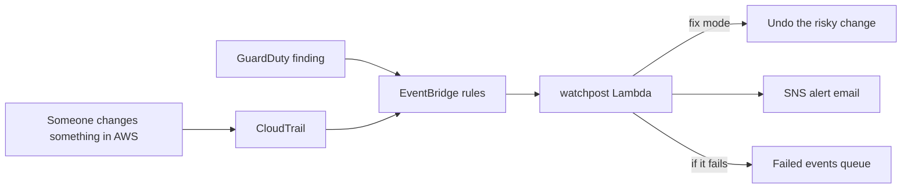

# watchpost

[](https://github.com/PrimelPJ/watchpost/actions/workflows/ci.yml)

watchpost watches your AWS account and reacts when something risky happens.

Someone opens SSH to the internet? watchpost closes it. Someone turns off CloudTrail? watchpost turns it back on. GuardDuty says a server was hacked? watchpost cuts it off the network and saves its disks as evidence. Every time, you get an email saying what happened, who did it, and what watchpost did about it.

It runs as one Lambda function and is deployed with Terraform.

## How it works



1. CloudTrail records every API call. GuardDuty looks for attacks.
2. EventBridge rules pick out the risky ones and send them to the Lambda.
3. watchpost checks the **current** state of the resource. If it is already safe, it does nothing.
4. In `fix` mode it undoes the change. In `alert` mode it only reports.
5. It sends an alert to SNS (email, Slack, PagerDuty, whatever you subscribe).

## What it catches

| Responder | Watches for | What it does in fix mode |
|---|---|---|
| `s3_public` | Bucket ACL, policy or public access block changes | Turns all four public access block settings back on |
| `sg_open` | SSH, RDP or every port opened to `0.0.0.0/0` or `::/0` | Removes only the internet part of the rule. Private ranges stay |
| `iam_admin` | `AdministratorAccess` attached to a user, role or group | Detaches it from users. Roles and groups are reported only |
| `cloudtrail_off` | `StopLogging`, `DeleteTrail`, weaker trail settings | Turns logging back on. Deletes and setting changes are reported |
| `root_activity` | Root sign-in, root access keys created | Alert only (flags sign-in without MFA as critical) |
| `gd_instance` | GuardDuty finding on an EC2 instance | Quarantines it: no-traffic security group, disk snapshots, termination blocked |
| `gd_access_key` | GuardDuty finding on an access key | Sets the IAM user's key to Inactive |

## What an alert looks like

```
Subject: watchpost CRITICAL: SSH (port 22) open to the whole internet.

Problem: SSH (port 22) open to the whole internet.
Resource: sg-0123456789abcdef0 (web)
What happened: arn:aws:iam::123456789012:user/dev-alex called AuthorizeSecurityGroupIngress from 203.0.113.24 at 2026-10-10T21:30:00Z
What watchpost did: Removed the internet part of this rule. Other sources in the rule stay.

Severity: critical
Mode: fix
```

## Try it without an AWS account

The demo builds a fake, badly set up AWS account with [moto](https://github.com/getmoto/moto) and runs every scenario:

```bash
pip install -e ".[dev]"
python scripts/demo.py           # fix mode
python scripts/demo.py --alert   # alert mode, nothing gets changed
```

## Deploy it

You need a CloudTrail trail that logs management events (EventBridge only gets API events when one exists).

```bash
cd deploy
cp terraform.tfvars.example terraform.tfvars   # set your email
terraform init
terraform apply
```

Confirm the email AWS sends you. Then you are done.

**Start in `alert` mode.** Watch the alerts for a week. Once they look right, set `mode = "fix"` and apply again.

**Regions.** IAM and console sign-in events only show up in `us-east-1`. Deploy there with `watch_global_events = true`. In every other region you use, deploy again with `watch_global_events = false`.

### Settings

| Variable | Default | Meaning |
|---|---|---|
| `mode` | `alert` | `alert` only reports. `fix` also undoes the change |
| `alert_email` | empty | Who gets the alerts |
| `watch_global_events` | `true` | Watch IAM and sign-in events (only in `us-east-1`) |
| `guardduty_min_severity` | `7` | Only act on GuardDuty findings this bad or worse |
| `disabled_responders` | `[]` | Turn off responders by name, like `["gd_instance"]` |

### Leave something alone

Some resources are meant to be open, like a public website bucket. Tag them:

```
watchpost:ignore = true
```

watchpost will still alert, but it will not change them. Works on buckets, security groups, IAM users and EC2 instances.

## Built to be safe

- **Least privilege.** The Lambda role only gets the permissions the fixes need. For example, it can detach `AdministratorAccess` from a user and no other policy (enforced with an IAM condition).
- **Never fails quietly.** If a fix fails, you still get an alert. The run is retried once, then the event goes to a dead letter queue, and a CloudWatch alarm emails you.
- **Safe to run twice.** Every responder checks the current state first. This is also why watchpost does not loop when it sees the event from its own fix.
- **Keeps evidence.** A quarantined server keeps running (memory evidence stays), its disks are snapshotted, and it cannot be terminated by accident.
- **Encrypted alerts.** The SNS topic uses its own KMS key with rotation on.

## Limits

- There is a short delay (usually under a minute or two) between the change and the fix.
- Swapping a server's security groups stops new connections, but connections that are already open may keep working for a while. For a full cut, also block the subnet with a network ACL.
- watchpost can turn off IAM user keys, but not temporary role credentials. For those, revoke the role's sessions in the IAM console.
- The tests and demo run against moto, a fake AWS. Try it in `alert` mode in a test account before using `fix` mode on anything real.

## Project layout

```
src/watchpost/handler.py       Lambda entry point: matches the event, runs responders, sends alerts
src/watchpost/core.py          Event, Action, settings and the responder list
src/watchpost/responders/      One file per area: s3, ec2, iam, cloudtrail, guardduty
events/                        Real-shaped sample events for every scenario
deploy/                        Terraform: Lambda, IAM role, EventBridge rules, SNS, KMS, SQS, alarm
tests/                         pytest + moto
scripts/demo.py                Runs everything against a fake AWS account
```

## Adding a responder

```python
@responder("ebs_public", "Alerts when an EBS snapshot is shared publicly.",
           api_call("ec2", "ModifySnapshotAttribute"))
def ebs_public(event, ctx):
    ...
    return [Action(responder="ebs_public", severity="high", resource=snapshot_id,
                   problem="Snapshot was shared with everyone.", response="Alert only.")]
```

Then add its event to `deploy/events.tf` and a sample to `events/`.

## Tests

```bash
pip install -e ".[dev]"
pytest
```

## License

MIT
